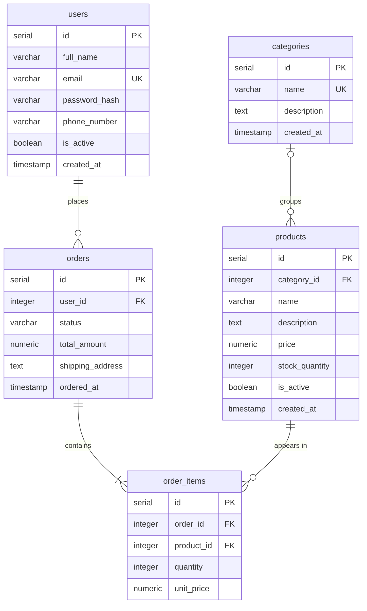

# RevoShop Database

PostgreSQL schema, sample data and example queries for the **RevoShop** online store.
Backend Development, Checkpoint 1 (covers Software Engineer Toolkit + Database with PostgreSQL).

## Repository structure

```
revoshop-db/
├── schema.sql      # CREATE TABLE statements for all 5 tables
├── seed.sql        # Sample data: 8 users, 5 categories, 15 products, 10 orders, 18 order items
├── queries.sql     # Example queries (WHERE + ORDER BY + LIMIT and more)
├── docs/
│   ├── erd.png     # Schema diagram (ERD)
│   └── erd.mmd     # Mermaid source of the diagram
├── .gitignore
└── README.md
```

## Schema diagram



| Relationship | Type | On delete |
|---|---|---|
| `users` → `orders` | one-to-many | `RESTRICT` (a user with orders cannot be deleted) |
| `categories` → `products` | one-to-many | `SET NULL` (a product is kept if its category is removed) |
| `orders` ↔ `products` via `order_items` | many-to-many | `CASCADE` on order, `RESTRICT` on product |

## Requirements

- PostgreSQL 16 (15 or newer should also work)
- `psql` in your PATH, and optionally pgAdmin 4

## Setup

### 1. Clone the repository

```bash
git clone <your-repository-url>
cd revoshop-db
```

### 2. Create the database

**With pgAdmin:** right-click *Servers → Local PostgreSQL → Databases → Create → Database*, name it `revoshop_db`, then click *Save*.

**With the terminal:**

```bash
psql -U postgres -c "CREATE DATABASE revoshop_db;"
```

### 3. Create the tables, load the data, run the queries

```bash
psql -U postgres -d revoshop_db -f schema.sql
psql -U postgres -d revoshop_db -f seed.sql
psql -U postgres -d revoshop_db -f queries.sql
```

You can also open each file in the pgAdmin Query Tool (right-click `revoshop_db` → *Query Tool*), paste the contents and press `F5`.

Both `schema.sql` and `seed.sql` can be re-run safely: `schema.sql` drops the tables first and `seed.sql` empties them and restarts the id counters.

### 4. Verify

```bash
psql -U postgres -d revoshop_db -c "\dt"
```

Expected row counts (last query in `queries.sql`): users 8, categories 5, products 15, orders 10, order_items 18.

## Design decisions

- **Naming:** `snake_case` everywhere, plural table names, primary key always called `id`, foreign keys named `<table>_id`, constraints named `pk_`, `fk_`, `uq_`, `ck_` + table + column.
- **Money:** `NUMERIC(12,2)` rather than floating point types, so prices never suffer rounding errors.
- **Data integrity in the database:** `NOT NULL`, `UNIQUE` (email, category name, one row per product per order), `DEFAULT` (timestamps, status) and `CHECK` (price > 0, stock >= 0, quantity > 0, valid order status).
- **Price history:** `order_items.unit_price` stores the price at purchase time, so changing a product's price later does not change old orders.
- **Indexes:** PostgreSQL does not index foreign keys automatically, so each foreign key column has an index to keep future JOINs fast.
- **Scope:** `users` has no `role` column on purpose; it is introduced as a schema migration in Checkpoint 2.
- **Passwords:** the sample `password_hash` values are dummy placeholders, not real credentials.
